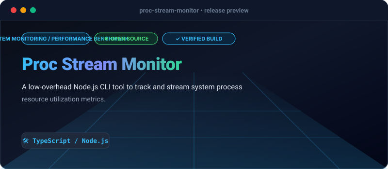

# Proc Stream Monitor

[](https://github.com/Olamideakinade/proc-stream-monitor)
[](https://opensource.org/licenses/MIT)



A command-line utility to monitor CPU and Memory usage of active system processes in real-time. Designed for low overhead and precise data extraction.

## Capabilities
- Real-time CPU/RSS memory tracking per PID.
- JSON output format for pipe-compatibility with downstream analytical tools.
- configurable sampling intervals.
- Error handling for restricted process access.

## Quickstart
```bash
npm install
npm run build
./dist/index.js --interval 1000
```

## Architecture
Uses `os` and `child_process` modules to query `/proc` (on Linux) or platform-specific APIs. The engine utilizes a non-blocking event loop to sample process states, minimizing the impact of the monitoring tool itself on the system.

## License
MIT